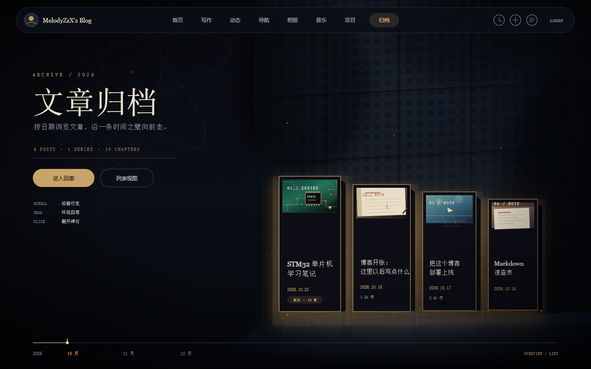

# 归档页 3D 重设计 · 调研与方案

> 状态：调研稿，**未动工**。视觉示意已出，先选方向，再出实现。
> 目标页：`/archive/`；现有实现：`src/pages/archive/index.astro`（122 行）。
> 结论先行：推荐 **「时之壁」**——把归档做成一座可以走进去的「时间之壁」：一整面刻满日期的石壁，每篇文章是一块被点亮的碑；滚动是沿壁前行，点击是取下一份档案。头顶一座缓慢转动的浑天仪，脚下是浅水倒影。Banner 用相册同款「幕布」掀开，作为入口。

**视觉示意**



- 首屏效果：[PNG](archive-3d-hero.png) · [SVG](archive-3d-hero.svg)
- 三方向对比板：[PNG](archive-3d-concepts.png) · [SVG](archive-3d-concepts.svg)

> 概念示意，不是最终视觉；比例、光效、材质以实机为准。

---

## 1. 现状：为什么必须重做

### 1.1 现在是什么

- 结构：`Banner` → 左侧栏（个人卡 / 搜索 / 分类 / 标签）→ `PageHeader`（标题卡）→ 按年月分组的竖线时间线。
- 数据：4 个归档条目，全部在 2026 年 10 月；其中 `STM32 单片机学习笔记` 是系列目录，含 10 章。
- 视觉：右栏只有 4 行，80rem 的双栏里大面积留白；页面重心落在左栏的狗头像上，而不是「时间」。

### 1.2 问题不是「不好看」，是「没有场所感」

1. 侧栏 + 标题卡 + 列表，是标准的「后台索引页」；它回答了「有哪些文章」，但没有回答「这些文章处在什么时间里」。
2. 时间线只有一条 1px 竖线和几个圆点，时间在空间里没有长度、没有方向、没有重量。
3. 4 篇文章撑不起双栏；越大的留白越显得内容少。
4. 系列 10 章被折进 `<details>`，归档页看不到「全部文章」。
5. 和相册的「照片海」相比，归档页没有任何「走进去」的体验；两个页面像两个站。

### 1.3 保留 / 拆掉

| 保留 | 拆掉 |
|---|---|
| Banner 的图与文案（作为入口幕布） | 左侧栏 `Sidebar` |
| 全部文章数据、系列章节、字数 | `PageHeader` 标题卡 |
| 明暗主题、导航、SEO、Pagefind | 旧竖线时间线 |
| 相册已验证的「幕布 + 固定舞台 + 滚动降级」模式 | 页脚（整屏画布页不需要） |

---

## 2. 数据现实：4 个条目，但设计要给 400 篇用

### 2.1 当前数据

| 日期 | 标题 | 类型 | 备注 |
|---|---|---|---|
| 2026-10-25 | STM32 单片机学习笔记 | 系列目录 | 10 章，全部 10-25 |
| 2026-10-18 | 博客开张：这里以后写点什么 | 单篇 | |
| 2026-10-17 | 把这个博客部署上线（不用买服务器） | 单篇 | |
| 2026-10-16 | Markdown 速查表：写文章只需要这些 | 单篇 | |

- 归档按 `getArchiveGroups()`（`src/utils/posts.ts:173-187`）分组；底层 `getListingPosts()`（`src/utils/posts.ts:103-106`）会把系列章节折叠成系列目录页。
- 所以现在「4 篇」是 4 个条目，不是 4 个文件；系列里还有 10 篇可读章节。

### 2.2 两个尺度必须同时成立

- **现在很稀疏**：4 个点集中在 9 天里。如果按真实日期比例铺一条时间轴，4 块碑会挤成一团，剩下 99% 是空白。
- **以后会变多**：上百篇之后，不能变成一堵密密麻麻、看不清的墙。
- **结论**：不做「按像素比例的时间轴」，做「有节奏的展陈」——年、月、篇三级；有文章的月份展开，没文章的月份收窄成暗龛；开头有「序」，结尾有「此刻」。稀疏不是缺陷，是叙事。

### 2.3 系列怎么放

- 系列目录页 = 一块「母碑」。
- 10 章 = 母碑背后的 10 道细光痕 / 10 片薄铜牌，靠近时展开；详情面板里列出完整章节目录（沿用现有 `chapterShortTitle`、字数）。
- 不把 10 章平铺进主时间线：它们同一天发布，平铺会变成 10 块同一位置的碑；而且归档的主轴是「文章」，不是「章节」。
- 可访问性上仍然保留 10 个真实链接（列表模式 / 详情面板），不会丢内容。

---

## 3. 参考研究：3D 时间线做对了什么

| 参考 | 它做对了什么 | 我们借什么 | 我们不借什么 |
|---|---|---|---|
| [200 Years](https://awwwards.com/sites/200-years) | 一条连续的 3D 路径，滚动穿过公司历史；里程碑是空间里的物体，不是卡片 | 单一空间主轴；滚动=前行；物件即内容 | 企业史的语气；音频叙事（首版不加） |
| [Painted Lineage](https://www.worldlabs.ai/labs/showcase/painted-lineage) | 1924–2025 的 31 个展点被一条时间路径串起来；地球只是容器 | **看得见的时间线**；焦点+上下文；系列成组 | 地球/地理维度（我们的轴是时间，不是空间） |
| [Living Archive](https://marketplace.framer.com/marketplace/components/card-gallery/) | 3D 空间画廊，滚动/拖拽，自动逐项聚焦，非焦点变暗 | 聚焦时压暗其余；平滑缩放；循环导航 | 通用「漂浮卡片」；没有场所的纯 gallery |
| [In Space We Trust](https://www.designrush.com/best-designs/websites/in-space-we-trust) | 复古仪器美学，克制的配色，交互时间线 | 仪器感；少量颜色；时间控制 | 复古元素堆叠；游戏化 UI |
| [Aisol Z Corridor](https://marketplace.framer.com/marketplace/components/aisol-z-corridor/) | 纯 CSS 3D 走廊，图片清晰，无 WebGL | **CSS 3D 足够做纵深**；文字/图片留在平面上 | 纯图片走廊（我们需要文字和时间结构） |
| [3D Image Stream](https://www.framer.com/community/posts/UidtrNmvuUyWCLWzReHdcK/) | `perspective + translate3d` 的电影感纵深；卡片从中心散开 | 透视、景深、雾；相机移动而不是页面滚动 | 无时间语义的图片流 |
| [Armillary sphere WebGL](https://github.com/s1vh-old-university-projects/VJ1221-PJ) | 嵌套圆环、反射材质、双层星空 | 浑天仪作为「时间仪器」；铜/黑/星的材质 | 首版不上 PBR/后处理；用 Canvas2D 画「铜版画」 |
| [Geotemporal Transurfing](https://discourse.threejs.org/t/geotemporal-transurfing-explore-history-through-space-and-time/94159) | 可暂停/倒放/快进的时间控制 | 给用户时间控制权（轨道尺、总览），不是只能滚 | 地球地图；复杂时间轴 UI |
| [Habr 3D 时间线滑块](https://habr.com/en/articles/966712/) | 把滚动值映射成「时间轴距离」，不是原始像素 | 滚动→时间距离的映射；透视滑块 | 纯滑块交互（我们会保留原生滚动） |

**非网页灵感**

- **碑林**（西安）：不是「一排墓碑」，是「把文字刻进空间，让人仰望、绕行、停留」。尺度、重复、阴影、拓片。
- **浑天仪 / 日晷**：时间不是数字，是一个可以转动的仪器；环、刻度、影子。
- **档案馆**：编号、印章、纸、铜牌、目录抽屉；「取出一份档案」的动作感。
- **电影**：《银翼杀手 2049》的雾与单束光；《沙丘》的尺度与仪式；《降临》的「时间作为空间」。
- **博物馆策展**：先给整体，再给局部；一件作品一个光点；留白是展陈的一部分。

**三条结论**

1. 好的 3D 时间线需要三件东西：**一条可跟随的路径**、**一个可读的锚点**、**一个能逃出去的总览**。多数 demo 只做了第一件。
2. 3D 的价值是「空间记忆」，不是「炫技」；如果用户找不到日期，3D 就是负资产。
3. 文字必须留在 DOM 里。canvas 里的文字再美，也不能选中、搜索、读屏。

---

## 4. 设计原则

1. **先造一个地方，再做一页 UI。** 用户应该能说出「我在一座壁前」，而不是「我在看一个 3D 列表」。
2. **时间是唯一主轴。** x = 时间，y = 层级，z = 深度；不要为了 3D 把内容散到四面八方。
3. **空白天也是展品。** 没有文章的日期保留为暗龛；「沉默」让稀疏变成叙事。
4. **文字优先。** 标题、日期、链接都是真实 DOM；3D 只是呈现层；列表模式永远可用。
5. **光有方向。** 一束暖主光 + 冷补光；不要满屏霓虹、发光渐变字。
6. **慢。** 相机、环、尘埃都慢；宏伟来自尺度、留白、材质，不来自粒子数量。
7. **一个强调色。** 琥珀/铜 + 印章红；站点粉只做「印章」这一下。
8. **可退出。** 列表、总览、Esc、减少动态；永远有一条回到普通网页的路。

---

## 5. 三个方向

### 方向 A · 时之壁 The Wall of Time（推荐）

**一句话**：一整面 18 米高的黑石壁，壁上刻满日期的壁龛；每篇文章是一块从壁里伸出来的发光石碑；滚动沿壁前行，点击取下一份档案。

**第一眼（幕布掀开后）**

- 相机在人的视高（约 1.6m），广角，离壁 6m，略微仰视，沿壁向右看。
- 右 2/3 是石壁，向左后方弯入雾里；左 1/3 是虚空，浑天仪悬在那里缓慢转动。
- 壁上有 4 块琥珀色石碑，高低错落，碑面刻着日期、标题、字数；一条细光沿壁在碑之间穿过，像星座连线。
- 一道暖光从画外右上方斜切下来，照亮尘埃和碑的前缘；左侧是冷蓝的补光。
- 地面是湿的黑石，碑和光的倒影被拉长；壁脚有一线浅水。
- 远处有一座 12 米高的拱门，门里是「此刻」的暖光；近处（相机背后）是入口，幕布留下的星空还在一角。
- 头顶的浑天仪：三层铜环，刻着年份、月份、二十八宿；转得很慢，影子在壁上移动。

**空间剖面**

```
              浑天仪（Canvas2D，铜线/星点，缓慢转动）
        ┌──────────────────────────────────────────────┐
        │   虚空 / 星尘                 ┌────────────┐  │
        │                              │  石壁       │  │
        │      ◎ 2026                  │  ▢ ▢ ▢ ▢   │  │
        │                              │  █  █  █    │  │ ← 碑（文章）
        │   光柱 ↘                     │  ▢ ▢ ▢ ▢   │  │
        │                              └────────────┘  │
        │  ~~~~~~~~~~~~ 浅水 / 倒影 ~~~~~~~~~~~~~~~~~~  │
        └──────────────────────────────────────────────┘
              相机沿 x 轴前行（滚动 = 时间前进）
```

**为什么它能同时解决「4 篇」和「400 篇」**

- **4 篇**：壁龛是满的（日期纹理），只有 4 格亮；空白天不是空白，是「没有被写下的日子」。入口有「序」（约 2 屏的接近段），出口有「此刻」（约 2 屏的尾声），所以空间旅程仍然有 5–6 屏，不会一眼看完。
- **400 篇**：壁是连续的；有文章的月份展开，没文章的月份收窄；多年之后，壁每年后退 120px、偏转 6°，自然弯成一条向深处的弧。只渲染相机附近 ±N 年，远处的碑降透明度/不渲染。
- **总览**：相机拉远，整面壁变成一张「博物馆立面图」，所有亮点都在；点一个亮点再俯冲进去。这是「所有归档文章」的答案。

**材质与光**

- 黑石（哑光、粗糙、有接缝和风化）；铜（细线、暗金、有刻度）；琥珀玻璃（半透、发光、碑面）；纸（详情面板、拓片）；浅水（倒影）。
- 主光 2800K 暖白，从右上 30°；补光 7000K 冷蓝，从左侧虚空；轮廓光在碑的后缘。
- 雾：远处壁面被 `mask` 吃掉，只剩轮廓；粒子是尘埃，不是雪花。
- 纹理：3–5% 的胶片颗粒/石头噪点，压住数字渐变的塑料感。

**碑的排版**

- 碑高 2.6m、宽 0.9m、厚 0.2m；从壁面伸出 0.6m，中心在 1.8m。
- 碑面从上到下：封面小窗（3:2，暗 60%，像一块彩色玻璃）→ 日期（mono，小）→ 标题（宋体，2–3 行）→ 字数 / 分类（小字）→ 底部一道「墨线」，长度按字数（对数）编码。
- 系列母碑背后有 10 道细光痕，靠近时像扇面展开；详情里列出 10 章。
- 碑的亮度按「离相机距离」衰减；只有当前焦点碑是满亮，其余 60%，远处 20%。

**交互**

- 滚动：沿壁前行；相机有阻尼，停下时缓慢归位；底部铜尺显示年份/月/篇，当前位置是一枚菱形滑块。
- 点击碑：相机滑到碑的 3/4 视角，碑转向相机 8°、向前滑出 0.4m；其余变暗；右侧滑出一张「档案页」（纸、封面、标题、日期、字数、摘要、阅读全文、章节列表）。左上角盖一枚朱红「归档」印章。
- 总览：相机拉远到整面壁；年份变成墙上的巨字；点亮点进入。
- 列表：一键切成普通列表（同一份 DOM），可键盘、可读屏、可打印。
- 键盘：Tab 逐碑，Enter 打开，Esc 关闭，←/→ 上一篇/下一篇，Home/End 首尾，G 总览，L 列表。
- 深链：`#2026-10` 定位到月，`#post-<slug>` 直接打开某篇，`#overview` / `#list` 进对应模式。

**文案**

- 入口：`向下 · 进入时之壁`
- HUD：`时之壁 / THE WALL OF TIME`；`2026 · 十月`；`4 个条目 / 10 章`
- 碑：`归档 004 · 2026.10.25`
- 结尾：`此刻 · 2026.11`；`时间继续向前。`
- 空态：`壁上还没有光。写下第一篇，这里就会亮起一格。`

**风险**

- 太像陵墓/纪念馆 → 用暖光、纸、封面小窗、朱红印章把它拉回「人的书房」，文案不要写「永垂不朽」。
- 壁龛网格太像服务器机柜 → 做不规则石缝、风化、手刻数字；不要霓虹网格。
- 斜面上的文字发虚 → 碑的偏转控制在 ±12°，必要时 billboard 朝向相机；实在不行，详情用 2D 面板。
- 暗色场景 + 浅色主题的导航冲突 → 给 `html.arc-page` 单独的导航皮肤（见 7.5）。

---

### 方向 B · 时轮 The Chronowheel

**一句话**：一座悬浮在星云里的巨型浑天仪；环 = 年，刻度 = 月，文章 = 环上的琥珀珠；一条光丝按时间串起所有珠子；拖拽转动，滚动沿时间螺旋。

**第一眼**：黑场，铜环占满画面，环上刻着年份和二十八宿；4 颗珠子在 2026 的环上，光丝从珠子间穿过；星尘缓慢旋转；相机在环外 3/4 角。

**交互**：拖拽旋转；滚动让环转动并把时间推向前；点珠子 → 珠子飞到画面中心，展开成一张环形卡片；系列 = 一小簇星座。

**优点**：最像「3D 建模」，最宏大，最符合夜空 Banner 的气质；一件仪器就是整个页面。

**代价**：

- **日期可读性差**：环上的角度不是线性的，用户很难建立「时间在往哪走」。
- **4 颗珠子太空**：一个巨大的仪器上只有 4 个点，要么加装饰星，要么加「每一天一颗暗珠」，后者会变成日历。
- **技术重**：真圆环、文字沿曲线、PBR/辉光，基本要 Three.js；移动端、可访问性、SEO 都要另做一套。
- **容易变成「炫技 demo」**：用户转两圈，找不到文章，就退回列表。

**结论**：不作为主结构；但把「浑天仪」作为方向 A 的**天顶仪器**保留——它负责宏伟和品牌，墙负责可读和时间线。

---

### 方向 C · 长河 The River of Time

**一句话**：一条发光的河从地平线流到观众脚下；文章是河上的灯笼/岸边的石碑；月份是桥，年份是巨拱；滚动是顺流而下（或逆流而上）。

**第一眼**：黑场，远处一条细光，近处水面铺开；4 盏灯笼浮在河面，倒影拉长；雾里有桥的剪影；星空低垂。

**优点**：最有诗意；直接呼应站点的「潮汐/照片海/幕布」；水的反射天然宏大。

**代价**：

- 归档的「索引感」弱：用户是在游河，不是在查档案。
- 文字在灯笼上很小；要做漂浮标签，容易乱。
- 真水面反射/焦散要 WebGL；CSS 只能做「假水」，效果打折。
- 4 盏灯笼在一条长河上，空得更明显。

**结论**：不作为主结构；把「浅水倒影」作为方向 A 的地面材质保留。

---

### 方向对比

| 维度 | A 时之壁 | B 时轮 | C 长河 |
|---|---|---|---|
| 宏伟感 | 高（尺度/对称/光） | 最高（宇宙/仪器） | 高（地平线/雾） |
| 时间可读性 | **高**（x 轴=时间，铜尺） | 低（角度/环） | 中（河流方向） |
| 稀疏数据 | **高**（暗龛/序/尾声） | 低（4 颗珠子） | 中（空河） |
| 规模扩展 | 高（连续壁/虚拟化） | 中（环上珠子会密） | 高（河无限长） |
| 技术风险 | **低**（CSS 3D + Canvas2D） | 高（Three.js） | 中高（水面） |
| 与站点气质 | 高（碑/档案/夜） | 高（星空/仪器） | 最高（海/潮汐） |
| 结论 | **主结构** | 天顶仪器 | 地面材质 |

---

## 6. 推荐方案：时之壁 · 星穹仪器

### 6.1 融合逻辑

- **墙 = 档案**：所有文章、日期、系列、字数都在墙上；可读、可链接、可 SEO。
- **仪 = 天**：浑天仪负责「宏伟」和「夜空品牌」；它是背景仪器，不承担导航。
- **水 = 海**：浅水倒影把站点的「潮汐/照片海」接过来；也是光的第二次曝光。
- **幕 = 入口**：Banner 用相册同款幕布掀开；幕布上的星空成为大厅的第一缕天光。
- 一句话：**「一座建在星海边的档案馆。」**

### 6.2 页面结构

```
/archive/
  BaseLayout banner={false} sidebar={false} fullBleed footer={false} htmlClass="arc-page"
  ├── .arc-curtain            ← Banner，100svh，普通文档流，z-index 10
  ├── .arc-stage (fixed)      ← 3D 舞台，100svh，z-index 0
  │   ├── canvas.arc-sky      ← 浑天仪 + 星尘（Canvas2D，aria-hidden）
  │   ├── .arc-hall           ← 石壁/拱门/地面/浅水（DOM + CSS 3D，aria-hidden）
  │   ├── ol.arc-timeline     ← 语义列表，同时也是 3D 里的碑
  │   │   └── li > a.arc-stele（日期/标题/字数/封面小窗/系列光痕）
  │   └── .arc-vignette       ← 雾/暗角/颗粒
  ├── .arc-track              ← 滚动空间：幕布 1 屏 + 时间线 N 屏
  ├── header.arc-hud          ← 标题/计数/总览/列表/分类
  ├── nav.arc-rail            ← 底部铜尺（年/月/篇）
  ├── dialog.arc-detail       ← 档案页（纸）
  └── noscript / list mode    ← 无 JS 的普通列表
```

**关键**：`ol.arc-timeline` 只有一份。3D 模式把每个 `li` 用 CSS `transform` 放到空间里；列表模式把 transform 清掉，它就是一个正常的、可读的 `<ol>`。不复制内容，不丢 SEO，不需要 canvas 文字。

### 6.3 视觉系统

**色板（夜馆 / 昼馆）**

| Token | 夜馆 | 昼馆 | 用途 |
|---|---|---|---|
| `--arc-void` | `#05070c` | `#e8e1d3` | 虚空/背景 |
| `--arc-stone` | `#0e121b` | `#d8cfbd` | 石壁 |
| `--arc-stone-2` | `#151b28` | `#c9bfa9` | 石壁受光面 |
| `--arc-brass` | `#c9a468` | `#8a6a35` | 铜环/刻度/细线 |
| `--arc-light` | `#ffd39a` | `#fff4dc` | 暖主光 |
| `--arc-cool` | `#b9d4ff` | `#7c93b8` | 冷补光/星 |
| `--arc-paper` | `#efe6d3` | `#fbf6ea` | 档案页 |
| `--arc-ink` | `#14110c` | `#1b1710` | 纸上的字 |
| `--arc-seal` | `#b8452f` | `#a83b28` | 印章/强调 |

- 夜馆不是纯黑：有石头的冷灰、铜的暖、星的蓝。
- 昼馆不是「把夜馆调亮」：是石灰岩、日光、深阴影；纸更白，铜更深。
- 站点粉只出现在印章/极小的焦点，不参与大面积。

**字体**

- 碑刻/标题：`"Songti SC", "Noto Serif CJK SC", "Source Han Serif SC", "SimSun", Georgia, serif` —— 中文宋体 + 西文 Georgia。**不新增 webfont**，用系统字体，避免几 MB 的中文字体下载。
- 日期/编号：`var(--font-mono)`（JetBrains Mono）。
- UI/按钮：站点现有 M PLUS Rounded 1c，保持「站点」的手感，和碑刻形成对比。
- 巨字：年份 `2026` 可到 240px，刻进墙里，只露边缘光；不要发光渐变字。

**版式**

- 第一屏：无大标题。只有左上角 `时之壁 / THE WALL OF TIME` 的小字，和底部铜尺。标题在 Banner 里已经出现过，进来后让空间说话。
- HUD 极简：左上 wordmark；右上「总览 / 列表」；左下计数；底部铜尺。
- 详情页：纸的版式，不是玻璃卡片；标题衬线、正文无衬线、元信息 mono；一枚朱印。

**材质**

- 石：`repeating-linear-gradient` 做接缝 + SVG 噪点 + 大半径暗角；不要纯色块。
- 铜：1px 线 + 低透明暖金渐变 + 少量高光；不要金属拟物渐变球。
- 琥珀玻璃：半透明底 + 内发光 + 边缘 1px 亮线；不要大面积 `backdrop-filter`（3D 里容易出层叠问题）。
- 纸：暖白 + 细颗粒 + 一道 1px 金线；不要圆角卡片的塑料感。

### 6.4 交互状态机

```
ENTER（幕布）
   │ 滚动过幕布
   ▼
WALK（沿壁前行） ──点击碑──▶ FOCUS（档案页）
   │  ▲                         │ Esc / 关闭
   │  └─────────────────────────┘
   ├── 点击「总览」 ──▶ OVERVIEW（整面壁） ──点击亮点──▶ FOCUS
   ├── 点击「列表」 ──▶ LIST（普通列表） ──点击条目──▶ 文章页
   └── 滚到底 ──▶ END PLATE（此刻 / 回到最早 / 总览）
```

- 焦点态锁滚动（`dialog` + `overflow:hidden`），关闭后回到原来的滚动位置和焦点。
- 总览态不锁滚动；再滚一下回到 WALK 的对应位置。
- 列表态是普通文档流，Banner 恢复常规高度；没有 fixed 舞台。
- 移动端只走 LIST/SCROLL，不做 3D 相机（见 7.6）。

### 6.5 数据映射

- **年**：一个「庭院」段，宽 1.6 单位；墙上的巨字年份；多年时每年后退 120px、偏转 6°，形成弧。
- **月**：有文章的月 = `0.9 + 0.8 × 篇数` 单位；无文章的月 = 0.35 单位（暗龛 + 刻字）。只展示「第一篇之后」的月份，不伪造建站前的历史。
- **篇**：月内按日期排序，间距 ≥ 1.1 单位；碑高按字数 2.2–3.2m（对数），宽固定。
- **系列**：母碑 + 10 道细光痕；详情里 10 章链接。
- **分类**：碑底一枚小色点（教程/随笔/学习笔记），不做整碑染色；图例在 HUD。
- **字数**：碑底「墨线」长度，对数映射；不写大数字，详情里给精确值。
- **此刻**：最后一篇之后到今天的「尾声」段，宽度 2 单位；如果今天没有新文章，这里是一段安静的光。

### 6.6 响应式

| 断点 | 行为 |
|---|---|
| ≥ 1200px，鼠标 | 完整 3D：幕布 + 固定舞台 + 相机 + 总览 |
| 900–1200px，鼠标 | 3D 但缩小尺度：壁更近，浑天仪裁切，HUD 更简 |
| < 900px 或触屏 | 滚动模式：Banner 常规高度（40svh），下面是一条「竖着的壁」——年份巨字 sticky，碑变成卡片，左侧一条光丝；无 fixed 舞台、无 3D 相机 |
| 无 JS | 服务端渲染的列表；CSS 默认列表，`<noscript>` 提示「已切换为列表视图」 |
| `prefers-reduced-motion` | 不自动转环、不视差；相机直接跳；默认列表或静态构图 |

---

## 7. 技术路线

### 7.1 三条路线

| | A. CSS 3D + Canvas2D | B. Three.js / WebGL | C. 混合 |
|---|---|---|---|
| 依赖 | 0 | `three`（核心 ~150KB gzip）+ 后处理 | 两套 |
| 文字 | 真 DOM，清晰、可选中、可 SEO | Canvas/SDF 文字或 DOM 投影 | 混合，复杂 |
| 几何 | 平面、盒子、圆环（CSS 可做） | 任意几何、PBR、反射、辉光 | 任意 |
| 光照 | 渐变/阴影/雾「画」出来 | 真光源、材质、Bloom | 混合 |
| 性能 | GPU transform，便宜；层叠要管 | draw call/填充率，移动端要降级 | 两套 render loop |
| 可访问性 | 原生 | 需另做 DOM 镜像 | 需镜像 |
| 风险 | 美术方向、depth sorting | 材质/光照容易「游戏感」、包体 | 对齐/同步 |
| 适合 | 墙、碑、走廊（平面为主） | 浑天仪、河流（曲面为主） | 墙 + 仪器 |

### 7.2 推荐：A（CSS 3D + Canvas2D），理由

1. **文字是内容，不是贴图**：碑上的标题、日期、链接必须是 DOM；CSS 3D 天然满足，SEO/读屏/选中/翻译全部保留。
2. **这个场景本来就是平面为主**：墙、碑、拱门、地面都是平面/盒子；CSS 3D 足够，而且边缘锐利。
3. **相册已经验证了这套模式**：幕布、固定舞台、滚动降级、星尘、换主题重绘；归档可以复用「结构」，不重复踩坑。
4. **浑天仪用 Canvas2D 画「铜版画」**：3 个圆环投影成椭圆，按 z 排序画线段，线宽/透明度随深度变化，28 个星宿刻度，缓慢旋转。它看起来像一张会动的铜版画，比 PBR 铜更贴合「碑/档案」的气质，而且零依赖、几十 KB 的绘制。
5. **包体/性能可控**：新脚本目标 < 25KB gzip，CSS < 15KB；不引入 Three.js 的 150KB 和第二个 render loop。
6. **失败可退**：CSS 3D 挂了/不支持，列表模式还在；Three.js 挂了就是黑屏。

> 如果之后你看了实机，觉得「不够真 3D」，我们再把「墙 + 浑天仪」换成 Three.js 版本；概念、数据、交互都不用变。**先验证美术方向，再决定引擎**，比一上来写 WebGL 稳。

### 7.3 模块

| 文件 | 职责 |
|---|---|
| `src/pages/archive/index.astro` | 数据、语义列表、HUD/铜尺/详情 dialog 的标记 |
| `src/styles/archive.css` | 夜馆/昼馆 tokens、幕布、舞台、墙、碑、HUD、铜尺、列表模式、响应式 |
| `src/scripts/archive-hall.ts` | 布局、相机、滚动映射、焦点/总览/列表、键盘、深链、清理 |
| `src/scripts/archive-sky.ts` | Canvas2D 浑天仪 + 星尘 + 主题重绘（可复用相册 Dust 的思路，但不改 2733 行的 `gallery-wall.ts`） |
| `src/components/archive/ArchiveStele.astro` | 单块碑的标记（列表/3D 双形态） |
| `src/components/archive/ArchiveRail.astro` | 铜尺（年/月/篇按钮） |
| `src/components/archive/ArchiveDetail.astro` | 档案页 dialog |

- 不改 `BaseLayout` 的公共逻辑；用 `fullBleed`/`sidebar={false}`/`footer={false}`/`htmlClass`。
- 不把逻辑塞进 `gallery-wall.ts`；两份场景的生命周期/状态机不同。
- 复用 `Banner.astro`、`getArchiveGroups`、`getSeriesList`、`wordCount`、`formatWords`。

### 7.4 相机与布局

```
scrollY
  │
  ├─ 0 .. curtainH        幕布阶段（enter = 0→1）
  └─ curtainH .. trackEnd 时间线阶段（p = 0→1）

p → 时间距离 t（按段宽单调插值，不是线性）
t → camX / camZ / yaw
world.style.transform = translate3d(-camX, -camY, -camZ) rotateY(yaw)
```

- 舞台 `perspective: 1200px`；`overflow: clip`（不要 `hidden`，相册踩过）。
- 墙在 `z = -600px`，碑在 `z = -450px`（伸出 150px）；地面 `rotateX(90deg)` 在 `y = +420px`。
- 相机只做 x 平移 + 极小 yaw（±2°）+ 极轻的 z 推拉；**不要 roll**，不要大幅旋转，防止晕。
- `rAF` 里只写 transform 和 CSS 变量；不读布局；滚动目标用 `passive` 监听。
- 每块碑按 `|x - camX|` 算 `--fade`，CSS 控制 opacity；远处不 blur（blur 贵），用雾层遮。
- `document.hidden` 时暂停 canvas；`prefers-reduced-motion` 时不跑相机缓动。

**布局算法（初版）**

```
UNIT = clamp(vw * 0.30, 260, 420)   // 一个「单位」的像素宽
segments = [prologue(2.0), year(1.6), ...months, epilogue(2.0)]
monthWithPosts.width = 0.9 + 0.8 * posts.length
monthEmpty.width = 0.35
x(post) = segment.x + 0.9 * UNIT + i * 1.1 * UNIT
```

- 4 个条目 + 1 个空月 + 序/尾声 ≈ 10 单位 ≈ 3–4 屏；加上幕布 1 屏，总滚动 4–5 屏。
- 100 篇 ≈ 80 单位；滚动很长，但铜尺可跳；`±2 年` 外的碑不渲染/不参与命中测试。
- 每年 `z -= 120px`、`yaw += 6°`，形成弧；超过 3 年再考虑「折叠老年份」。

### 7.5 主题 / 导航

- `html[data-theme-type='dark']` → 夜馆；`light` → 昼馆。所有颜色走 `--arc-*`，不直接吃 `--b1`（站点的卡片色太软，撑不住石材）。
- 归档页的导航需要单独皮肤：`html.arc-page` 下把导航的文字/边框/背景改成夜馆/昼馆的玻璃；否则浅色主题的深字会压在黑壁上。
- 换主题：`MutationObserver` 看 `data-theme`/`data-theme-type`，重读 `--arc-*`，重绘 Canvas2D；不要重建 DOM。
- Banner 图的颜色只影响入口：幕布下缘加一道暖色渐变，和壁的第一道光接上；不要让整页跟着 Banner 变成蓝紫。

### 7.6 性能 / 可访问性 / SEO

**性能预算**

- 新 JS < 25KB gzip；新 CSS < 15KB；不新增 webfont；不新增图片请求（封面懒加载，只在详情/碑面小窗用）。
- 60fps 桌面；移动端滚动模式 30fps 即可；`dpr` 上限 2；canvas 面积按视口。
- 首屏 LCP < 2.5s；CLS = 0（幕布高度用 `svh`，图片有尺寸）。
- 长任务 < 50ms；初始化分两帧（先布局，再开相机）。

**可访问性**

- `<ol>` 是唯一内容源；所有碑是 `<a href>`；架构 `aria-hidden`。
- 跳转链接「跳到归档列表」；焦点可见；`dialog` 焦点陷阱 + Esc + 关闭后回焦。
- 键盘：Tab/Shift+Tab、Enter、Esc、←/→、Home/End、G、L；帮助浮层 `?`。
- `aria-live` 播报「已定位到 2026 年 10 月」「已打开第 4 篇」。
- 颜色不是唯一信息：分类有文字/图标；当前项有 `aria-current`。
- `prefers-reduced-motion`：无自动旋转/视差；相机直接跳；默认列表也可。
- 200% 缩放、纯键盘、无鼠标、无 JS 都能读。

**SEO**

- H1「文章归档」+ 一段可见的简介（不是只有 3D）。
- 所有文章链接、系列章节链接在 DOM；不依赖 canvas。
- JSON-LD `CollectionPage` + `ItemList`；标题/日期/URL。
- Pagefind 能索引标题/摘要；装饰层 `data-pagefind-ignore`。
- 深链可分享；`#post-...` 打开详情，但不影响爬虫看到列表。

### 7.7 风险与对策

| 风险 | 表现 | 对策 |
|---|---|---|
| 斜面上的文字发虚 | 碑旋转 20° 后标题糊 | 偏转 ≤ 12°；必要时 billboard；详情用 2D 纸页 |
| 3D 层叠闪烁 | 半透明碑互相穿透 | 不透明底 + `translateZ` 间隔；少用 `backdrop-filter` |
| 相机晕 | 滚动太快/转向太多 | 只 x 平移 + ±2° yaw；阻尼；减少动态 |
| 稀疏显得空 | 4 块碑在大厅里 | 暗龛纹理 + 序/尾声 + 总览；文案把「空」讲成「未写下」 |
| 暗色 + 浅色主题导航冲突 | 浅色主题下导航字看不清 | `html.arc-page` 单独导航皮肤 |
| 移动端卡顿 | 固定舞台 + 3D | 触屏/窄屏直接滚动模式；不做相机 |
| 无 JS 白屏 | 舞台 fixed 但没内容 | 默认列表；`arc-js` 才启用 3D；脚本异常回退 |
| 未来 100+ 篇 | DOM/滚动太长 | 虚拟化 ±2 年；老年份折叠；铜尺跳转 |
| 美术跑偏成「游戏 UI」 | 发光边框/霓虹/粒子 | 材质约束：石/铜/纸/水；光只一束；粒子只尘埃 |

---

## 8. 实施阶段（确认方向后）

| 阶段 | 产出 | 验收 |
|---|---|---|
| P0 视觉定调（0.5–1 天） | 夜馆/昼馆 tokens、字体、第一屏静态构图（1440/390） | 只看截图就能判断「宏伟/不宏伟」；不改数据 |
| P1 结构（1 天） | 语义列表 + 3D 布局 + 相机 + 铜尺 | 滚动能走完 4 篇；列表模式可读；键盘可达 |
| P2 入口（0.5 天） | 幕布 + HUD + 进入动效 | 幕布掀起自然；返回顶部能回到 Banner |
| P3 聚焦（1 天） | 档案页 dialog + 系列章节 + 深链 | 点碑开页；Esc 回原位；`#post-...` 可分享 |
| P4 总览 / 列表（0.5 天） | 总览相机 + 列表切换 | 总览能看到所有亮点；列表可打印 |
| P5 移动 / 降级（1 天） | 滚动模式 + 无 JS + 减少动态 | 390px 无横向滚动；关 JS 仍可读 |
| P6 打磨（1 天） | 性能/可访问性/SEO/文档 | Lighthouse、键盘、读屏、构建全过 |

> 总计约 5–6 个工作日（或 5–7 个晚上）。每一步都可单独验收，不一次性重写。

---

## 9. 待确认

1. **方向**：A 时之壁 / B 时轮 / C 长河？我推荐 A，B 的浑天仪并进 A 的天顶。
2. **3D 技术**：CSS 3D + Canvas2D（推荐，文字清晰、零依赖）还是 Three.js（真几何、更重）？
3. **气质**：默认夜馆、浅色主题切昼馆（推荐）；还是整页固定夜馆；还是完全跟随现有主题？
4. **入口**：相册同款幕布掀开（推荐）；还是保留常规高度 Banner，下面直接进 3D？
5. **时间方向**：最早 → 现在（滚动=前进，推荐）；还是最新 → 最早（博客惯例）？
6. **手机**：2.5D 竖向时间线（推荐）；还是坚持手机也做 3D 相机？
7. **系列**：母碑 + 10 道光痕 + 详情章节（推荐）；还是每章一块碑 / 一个侧龛？
8. **首版范围**：总览 + 列表 + 深链（推荐）；分类筛选、标签、搜索是否进首版？

---

## 10. 附：和现有代码的接口

- 数据：`getArchiveGroups()`、`getListingPosts()`、`getSeriesList()`、`seriesTotals()`、`wordCount()`、`formatWords()`、`formatDate()`、`isoDate()`、`postUrl()`。
- 布局：`BaseLayout` 的 `banner={false}`、`sidebar={false}`、`fullBleed`、`footer={false}`、`htmlClass="arc-page"`。
- 幕布：参考 `src/pages/album.astro` 的 `.gal-curtain` + `.gal-spacer` + `--gal-enter`；但归档的 track 更长，`p` 要减去幕布高度。
- 星尘/主题：参考 `src/scripts/gallery-wall.ts` 的 `readColors()`、`buildGlow()`、`resize()`（dpr 上限 2、星点 `clamp(area/11000, 50, 180)`）；归档写自己的 `archive-sky.ts`，不改相册脚本。
- 构建：`npm run build` 会跑 `stamp-html.mjs` + Pagefind；新页面要保证 Pagefind 能索引列表文本。
